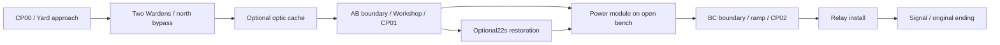

# Phase06 — The Dead Station candidate

Status: implementation in progress; not a completed or pacing-accepted chapter.
Owner authorization: Phase06 brief and manual streaming-door request, 2026-11-01.
Baseline: `de958e134a4d8f1f86b5d3a170378856743b8693`; branch `phase-06-complete-chapter`.

## 06A director's cut audit

The owner played the unchanged Phase055 Windows Development package with headphones, then explicitly released game input for verification. Their report: approximately **2 minutes**, reached the ending, no obvious hitch. This is an actual owner playtest; first-time/uncoached status and audio-quality acceptance were not reported. No claim of a 12–16 minute existing chapter is justified.

The preserved native log belongs to that same ordinary process, without acceptance flags. Local evidence: `.environment-local/phase-06/audit/owner-phase055-playtest.log`. The initial save scan found zero valid saves. Timeline below uses UTC log timestamps; it measures event boundaries, not attention, looking, reading or exclusive movement time.

| Event | UTC | Delta / interpretation |
|---|---|---|
| Startup save scan | 22:48:23.716 | Menu/startup included in owner's approximate estimate |
| CP00 write requested / completed | 22:48:52.002 / 52.011 | New route boundary |
| First enemy damage / last defeat | 22:48:53.408 / 58.101 | 4.693s from first successful hit to second defeat; not full combat attention time |
| Yard optic collected | 22:49:01.973 | Optional pickup actually discovered |
| Workshop objective | 22:49:17.337 | 25.335s after CP00 request |
| CP01 completed | 22:49:18.342 | Real native save callback |
| Optional assembly start / completion | 22:49:23.102 / 45.103 | 22.001s; full optional sequence |
| Module collected | 22:49:55.274 | Workshop interval37.937s, including assembly; other15.936s cannot all be labelled exploration |
| CP02 completed | 22:49:58.520 | Real native save callback |
| Relay interaction | 22:50:02.847 | 7.573s after module |
| Signal / ending start | 22:50:05.424 / 05.426 | 10.150s after module |
| Ending finished | 22:50:06.165 | 0.739s presentation; exact skip input not logged |
| Exit | 22:50:13.494 | Normal menu exit |

CP00 request to ending finished = **74.163s**. Startup scan to ending = **102.449s**. The owner estimate and log intervals are separate evidence. No death/recovery, return traversal or confusion was reported; absence of a report is not a pass for those cases.

Read-only installed Editor audit: four native maps loaded successfully, process exit0. Full actor/class/location/bounds/mesh inventory is local `audit/map-audit.json`; the persistent-world enumeration includes loaded sublevels and must not be summed as independent actors. CP00(-1450,0,110), CP01(2050,0,110), CP02(4050,0,-40.1886) remain fixed. Yard floor36x28m; Workshop20x14m; bunker room18x13m plus18m ramp. Main progression is approximately86m along X. Baseline streaming doors became invisible instantly when native readiness succeeded.

Three principal weaknesses:
1. Progression offers almost no observation/decision between adjacent mandatory interactions. The module is collected without diagnosing machinery; the mechanic identity is primarily a cinematic.
2. The underground zone is a short ramp and two consecutive prompts, with no distinct player-controlled climax.
3. Combat, optional discovery and destination compete in a very small yard. The first successful hit occurs1.4s after CP00, leaving little introduction. No substantial exploration time is supported by this run.

## Candidate design and decisions

Keep the same three streamed zones, checkpoints and accepted weapon/AI/UI/audio authority. Prefer local actor mechanics over a puzzle framework or new saved-ID migration. A wholesale larger level would cost substantial new environment/navigation validation; merely slowing the player or stretching cinematic timing would not solve the audit. The selected incremental candidate adds actual observation and control operations, improves spatial screening/route readability, and must be timed again. **12–16 minutes remains an acceptance target, not an estimate guaranteed by this plan.**

- Opening: screen immediate Warden sightlines using industrial cover; establish the warm Workshop destination and an optional maintenance-record detour. Preserve the north bypass and existing enemy identities.
- Boundaries: E-operated Workshop roller shutter and relay mechanical door. Open request triggers native neighbor load. Visible mechanical travel, status and spatial cues. Passability requires both native readiness and complete motion. No crush, unload-through-open-door or closing on a player. Closing/backtracking works from both sides; F5 remains retry. Door state is transient.
- Workshop: fictional diagnostic rack using labelled route/check/release steps. The test result is visible, wrong ordering gives a recoverable explanation, and the existing module becomes collectible only after release. Existing optional optic bench remains independent.
- Relay Access: short machinery cycle with a clearly marked safe path/refuge and a local stop control. No electrical-repair simulation or extra enemies. Clear machine state, recoverable retry, and a safely latched return route. The original module install and ending remain.
- Minor mechanical progress lives only in GameMode session state. Collecting the original module implies the Workshop activity is complete; restoring relay power implies the access activity is complete. CP01 replays the diagnostic after rollback; CP02 replays unfinished access. Old saves remain valid without appending IDs/checksum changes.
- Main-menu artwork uses aspect-preserving fill/crop; editable title remains separate.

All new equipment text is **provisional environmental instruction**, not additional world history. No new voice, music, faction, biography or MERIDIAN explanation.

## Implementation and verification plan

- [x] Preserve owner log, verify baseline/engine/branch, inspect native maps and existing authority.
- [x] Add and test door/diagnostic safety policy, integrate native actors and existing interaction routing.
- [x] Author actual map changes through Editor; preserve anchors/old IDs and inspect collisions/readability. Final rendered review remains separate below.
- [x] Compile integrated C++, then focused native fixtures for door readiness/closing, diagnostic rollback and existing checkpoint/workbench lifecycle. See bounded repairs and test evidence below; package acceptance remains separate.
- [x] Inspect native1080p/1600p UI captures and actual-input door/mission/ending routes. Human flow/bypass/art inspection remains open.
- [x] One final Windows Development package; limited independent CP01/CP02 processes and actual menu route.
- [x] Controlled unchanged Phase055 vs candidate Epic1080p runs, with changed-route limitations documented; one separate justified warm Insights diagnostic. No cache-clearing or silent quality reduction. Performance acceptance remains open.
- [ ] Source/license and staged-file review, coherent commits, push and PR to main (no merge).

## Performance research

Epic UE5.8 [PSO Precaching](https://dev.epicgames.com/documentation/unreal-engine/pso-precaching-for-unreal-engine) documents asynchronous collection, default component precaching and delayed proxy creation. Validation distinguishes missed/late PSOs; a frame spike alone does not establish a PSO cause. [Unreal Insights](https://dev.epicgames.com/documentation/unreal-engine/unreal-insights-in-unreal-engine) and [Slate Insights](https://dev.epicgames.com/documentation/unreal-engine/slate-insights-in-unreal-engine) are the focused CPU/asset/UI investigation pathways. Preserve native defaults until paired telemetry identifies a worthwhile change. Do not build the engine from source.

## Private playtest sheet

Use a normal launch, actual New Game, no console commands/coaching. Record display preset/resolution, whether familiar with prior builds, start/end wall time, ending reached, deaths/recovery time, locations of objective confusion, optional optic found/installed, diagnostic comprehension, machinery route comprehension, door/backtrack behavior, input/Pack problems, notable hitches, audio balance, story curiosity and enjoyment/frustration. At least two first-time human runs are preferred. Record unavailable data as unknown. Agent state fixtures are never human pacing evidence.

## Validation ledger

- 06A read-only map audit: installed UnrealEditor-Cmd, `-run=pythonscript -NullRHI`, exit0; no assets saved. Not visual or performance acceptance.
- Owner Phase055 evidence above is the sole current human route report. Candidate duration and human visual/audio acceptance are pending. Do not interpret automated route duration as first-time pacing.

### Native implementation and bounded repairs

Five original modeled meshes were imported through UE5.8.4; four existing maps were saved natively. All three checkpoint transforms were compared numerically before/after save/reload. The Panel02 control initially intersected the old broken-machine collision; moving it to the machine's accessible front fixed an actual E-interaction timeout. The historical failure remains in `runtime/editor-route2.log`; corrected `editor-route2-clearance.log` passed with exit0. The always-open machine bypass uses the south walkway because the north edge contains existing rack collision.

Editor C++ compilation passed (`audit/editor-integrated-build.log`, exit0,37.00s). The first integrated compilation exposed an existing anonymous-namespace `Groups`/`Expected` Unity collision; names in interface acceptance were made specific without behavior changes. The existing UButton::IsFocusable deprecation remains a warning, not a clean-warning claim.

The 16:10 fix reparents only the existing background into ScaleToFill plus a1920x1080 source-size wrapper. Existing WidgetTree children/bindings remain. Two unsuccessful registration repairs triggered the stop rule; after diagnosis, the owner explicitly authorized the native registration approach. `UWidgetBlueprint::OnVariableAdded` now registers wrapper GUIDs, and UMGEditor is linked **only in Editor targets**. Compilation and native asset save succeeded (`audit/editor-native-registration-build.log`, `audit/editor-authoring-native-registration.log`). Actual packaged aspect inspection is still a separate gate.

### Functional evidence, not human pacing

| Evidence under `.environment-local/phase-06` | Actual result | Limit |
|---|---|---|
| `audit/native-tests.log` | Checkpoint schema, restoration session and Phase06 checkpoint derivation passed; process0 | Initial FieldPack filter matched no tests; do not count it |
| `runtime/editor-route1.log` | Actual combat/slide/E-door route reached native CP01 success | D3D Editor-game shutdown stalled; owned process stopped after30s, exit-1; not a normal-exit pass |
| `runtime/editor-route2-clearance.log` | Separate CP01 Continue; all diagnostic steps, module, optional restoration, pause/Abort/restart/natural finish, reload, E-door and CP02 save passed; exit0 | NullRHI functional fixture, no visual/audio/performance acceptance |
| `runtime/editor-route3.log` | Separate CP02 Continue; three recovery/return cycles, streaming unload/reload, death/Retry/Restart, upgrade state, machinery stop and both original ending paths passed; exit0 | Same NullRHI limit |
| `runtime/editor-gate-check.log` | Loading hold, cancel/unload and failure protection passed; Esc freeze failed | Preserved failing evidence, process0 does not imply acceptance |
| `runtime/editor-gate-repair1.log` | After explicit same-frame pause guard, all thirteen gate stages and native CP01 passed; process0, no forced stop | Actual E actions and real native barrier/level observations; readiness/failure intentionally injected only by opt-in fixture |

Installed `LevelTick.cpp` caches the pause state before actor ticks are queued. The gate fixture exposed one already-queued tick after pause; the first focused repair added an explicit paused-world guard to door and shuttle movement. The rerun recorded `menu=1 paused=1 pose=1 world_delta=0 blocked=1`. It also verified closing freeze in Field Pack, input/cursor restoration, geometry retention until seal, reversal and actual E rejection with the capsule in the doorway. No existing PlayerController input architecture was replaced.

The small engine-independent mechanics policy test also passed after observed red cases for retention and closed-machine approach. Tests use CR04_TEST_ prefixes exclusively. No owner save was deleted, corrupted or replaced.

### Final Development candidate and UI evidence

One integrated Windows Development BuildCookRun succeeded, AutomationTool exit0,141.38s. Local package: `.environment-local/phase-06/package/Windows/CinderRelay.exe`; launch without route/acceptance flags for normal play. No Shipping build was made because pacing/performance/human acceptance gates remain open.

The final package passed all three independent actual-input checkpoint processes (`packaged-acceptance/process-results.json`): launcher/native exit0 throughout, no forced stops. CP01 Continue, CP02 Continue, native unload/reload and return traversal, enemy/pickup persistence, slide/reload, assembly Skip/Stop/Abort/restart/death/controller teardown, death Retry, Restart Chapter and both original ending paths are covered. These are functional fixtures, not a natural first-time playthrough. `audit/native-integrated-tests.log` separately reports three Success results: Phase06 checkpoint derivation and both FieldPack projection/availability tests, exit0.

Two separate packaged UI processes (`interface/process-results.json`) passed at actual1920x1080 and2560x1600, both exit0. Native screenshots include main menu, Settings, confirmation, HUD, Pack equipment/mission items, pause and low health. Model inspection found aspect-preserving title crop and intact menus/Pack at both sizes. This is not human visual acceptance. Fifteen native UI screenshots and the two13.33/13.35s stereo48kHz mixed-output WAVs remain local. The WAVs are non-silent (peak0.2074/0.2070, RMS approximately0.0030), with zero near-full-scale samples; numeric checks do not establish headphone mix quality or absence of perceptual masking.

A separate **actual mouse/keyboard menu check** copied the Phase055 dedicated test-slot pair byte-for-byte to fresh CR04_TEST_Phase06LegacyCP02 slots, clicked Continue, opened I/Field Pack, selected Mission Items, closed it with Esc, opened pause and confirmed Exit Game. Native validation restored the old schema1 CP02: health68, magazine1, reserve25, no optic; the pack showed Power Module CARRIED/01. Reconstruction33.654ms; OS exit0. See `runtime/legacy-save-copies.json`, `legacy-ui.log`, `legacy-ui-exit.json` and `legacy-field-pack.png`. Original source test files and all owner save files were untouched. No complete human route is claimed for this agent UI check.

Six Editor frames under `visuals-integrated/` inspect original meshes, cover, Workshop controls and the underground space; process0 and no preview camera saved. The notice board subsequently received a noncolliding size/material correction for readability through native Editor authoring. Its final in-package readability still needs owner inspection. These Editor images are not gameplay traversal evidence.

**No usable Phase06 gameplay video is delivered.** The first desktop recorder missed the game window; the bounded window-only repair captured a frozen reload frame while native logs/screenshots advanced through pause and low health (`video-window/freeze-check.log`, freeze_start0). Both recordings are explicitly rejected, despite successful encoding/functional receipts. Original native WAVs and genuine screenshots are retained; no slideshow, unrelated audio or frozen frame is represented as a gameplay movie.

### Remaining demo gates

- **Pacing/content density:** the measured owner baseline was about2min. The new candidate is not timed by a human and the compact retained footprint does not substantiate12–16min. This incremental content pass must not be called the finished narrative chapter. A further meaningful layout/content pass may be necessary after timed feedback; do not stretch waits, walking speed or cinematics.
- **First-time comprehension:** no two uncoached first-time playtests have been conducted. Diagnostic discoverability, optional optic discovery, bypass clarity, combat feel, story curiosity and frustration remain open.
- **Performance:** primary active-pawn p95 remains above16.67ms; see PERFORMANCE_BUDGET. No optimization is credited without measured causality. First-process startup and cache-cold hitches were not fully instrumented by the primary route.
- **Diagnostics:** the one traced warm run reached its functional CP01 receipt but returned777003 after native requested exit0. Installed Core names this CrashReporterCrashed. The cause remains unresolved; it is excluded from successful process counts. Offline Insights exported CPU timing but reported allocation-tag errors; no allocation/residency conclusion follows from that trace.
- **Presentation/evidence:** no usable continuous video or human stereo-headphone acceptance; original synthetic mechanical cues are reused, not new bespoke door recordings. The shuttle has pure-policy safety checks and actual completion coverage, but no separate native occupancy fixture. Native gate edge coverage specifically exercises AB; BC is exercised by forward/backtracking routes.

The PR is a **draft candidate**, not a Phase06 acceptance declaration. Do not start Chapter02/Phase07. Recommended next milestone only after these gates close: consolidate private-playtest fixes, reproducible performance and presentation polish for a small closed demo; avoid expanding systems or chapter count.
