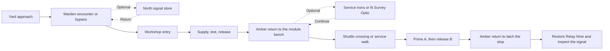

# Chapter 01 expansion

## November 18 playable remake

The owner chose a remake of the first chapter around Elias's repair work. The new equipment behavior and signage are gameplay proposals within the original Dead Station story. Each section changes where the player can go.

| Location | Action and consequence |
| --- | --- |
| Rail Yard | The yellow booth near CP00 operates the north transfer hoist. Press E to raise the service wagon 310 cm over 2.8 seconds. Walk underneath for a direct route to the Signal Store and the east flank. The pump makes a spatial sound that the existing scouts can investigate. The east entrance remains available without using the hoist. |
| Workshop | Routing supply and verifying the load open folding safety gates in the test hall. Releasing the cradle opens a crosswalk through the gridded gallery to the amber return lane. Take the released module from the original bench. Servicing the sights is optional. |
| Relay Bunker | Priming the bus opens the breaker passage. Releasing the interlock opens a transverse passage to the stop-control return walk. Fit the module at Relay Nine, then inspect the console in front of the carrier meter. The physical pointer follows the power and signal sequences. |

The hoist state lives in the chapter session and is derived from progression when restoring an older CP01 or CP02 save. The five interior gates derive from the existing diagnostic and service steps. The center of each passage blocks a standing player until the leaves have finished opening. Hoist and gate motion stop ticking at rest. Ending playback supplies the time for the meter animation, including pause. The title and F1 guide share an original illustrated section of the three sites. The HUD draws the current action and its second-line route cue separately.

The Windows Development build is archived under `.environment-local/phase-06/remake/package/Windows`. Evidence for this revision lives in `.environment-local/phase-06/remake/`. [Build, acceptance and cleanup](MILESTONES.md#november-18-chapter-01-remake). [Model and sound sources](ASSET_SOURCES.md).

Phase06 extends The Dead Station using the three original streamed maps. The design target is 12–16 minutes for an uncoached first completion. Measure that separately from automated traversal and interrupted checkpoint tests.

## References and original decisions

- Respawn built Titanfall 2's campaign from distinct playable prototypes. The expansion applies that approach through optional salvage under pressure, ordered module diagnosis, and an auxiliary startup loop below the relay. [Respawn's GDC talk on action blocks](https://www.gdcvault.com/play/1025105/Designing-Unforgettable-Titanfall-Single-Player).
- Metro Exodus uses story progression through non-linear exploration spaces. This chapter uses that idea at a smaller scale. An original signal store branches off the main route and houses the existing optional yard optic. [Metro Exodus publisher description](https://store.steampowered.com/app/412020/Metro_Exodus/).
- The Last of Us Part II offers independently configurable HUD, subtitles and navigation assistance. Cinder Relay makes instructions available from the title screen and F1 while keeping the live objective short. [Naughty Dog accessibility overview](https://blog.playstation.com/2020/06/09/the-last-of-us-part-ii-accessibility-features-detailed).
- The Last of Us Part II workbench shows the relationship between selecting an upgrade and fitting it. Cinder Relay uses its own components, hand rig and sounds, with an authored framing and timing pass. [PlayStation workbench preview](https://blog.playstation.com/archive/2019/09/26/hands-on-with-the-last-of-us-part-ii-new-gameplay-details-revealed).

No external geometry, text, animation or UI assets were imported. The added equipment labels and service procedure are provisional gameplay material under the existing Story Bible.

## Route and architecture

| Space | Play and spatial layout | Existing anchor |
| --- | --- | --- |
| Rail Yard | Retains the encounter and adds a framed opening to a 31.5 × 19.6 m north service apron. The signal store is an enclosed optional branch with the original yard optic and its stable ID. | CP00 |
| Workshop | A 20 × 49.7 m south annex has three numbered bays, offsets in the interior partitions, and an independent amber return corridor. Route supply, verify load and release the cradle in order. Return to the original bench for the module. | CP01 |
| Relay Bunker | Cross the existing moving shutter or its service walk. An 18 × 53.5 m auxiliary annex follows an A-to-B service route around a separated spine. Follow the amber return lane to latch the original machinery stop, then restore the relay and inspect the signal. | CP02 |

Linked enclosures, beams, jambs, lit control stands, floors and contrasted signs replace the straight collection path. `Scripts/expand_chapter06.py` is the editable native authoring entry. It updates owned expansion Actors and selected existing walls/stations, and preserves all checkpoint transforms. Its new players' floor surfaces retain simple native collision. New prop structures stay inside each original X-axis streaming region. Service progress is session state and resets at a checkpoint rollback. An already-restored relay derives completed service work from its existing objective. Schema1, stable identifiers and the final MERIDIAN screen are retained.

## Field Guide and bench

The title identifies the chapter and opens a dedicated F1 Field Guide, which also works from normal play by pausing it. The guide shows the current objective and the area procedures. The selected workshop and relay step also appears in the live HUD. Menu buttons and the guide remain accessible by keyboard; ordinary Continue and New Game preserve their original storage and confirmation behavior.

Face the bench and press **1** for the 3.2-second iron-sight service, or **E** to fit a recovered Survey Optic. Both choices enter the native camera and movement transaction. The shorter service uses the original initial inspection motion and new camera keys. The optic fit uses a new 22-second skeletal animation derivative on the established 40-bone workbench skeleton. `retime_optic_fitting.py` applies one mapping across all 162 hand, grip and prop curves; the original Blender project remains the input. `author_chapter06_workbench.py` changes camera stages for reach, alignment, seating and return and moves the original seat/secure cues with the action. Tab skips and commits the chosen build. A stop, death or teardown cancels it. Iron sights maintain the wider 65-degree view, and the Survey Optic uses 60 degrees. Switching back to iron after fitting is valid in the current run. Checkpoint restoration defaults to the recovered optic when installed, because active sight selection is not a new save field.

## Acceptance evidence

Raw local evidence is under `.environment-local/phase-06/expanded/`. UE5.8.4 native map authoring added 157 Actors and saved/reloaded all three maps, exit 0. Blender 4.5.11 exported the editable derivative and the native editor imported the 22-second action on its existing Skeleton, exit 0. The native camera verification sampled both sequences and confirmed that Stop restored the camera. These are editor checks, separate from runtime feature tests and player pacing acceptance.

- Native render evidence at 1920×1080 is under `visuals/`. It includes an exterior view of the signal store, the new Workshop and underground controls, and three frames from the new optic presentation.
- `RunUAT BuildCookRun -platform=Win64 -clientconfig=Development -build -cook -stage -pak -archive` finished with exit 0, cooking 813 packages. The initial build stopped on a C++ slot-name shadowing error. The corrected full archive and the error are recorded in `package-corrected.log` and `package.log` respectively.
- `Scripts/run_interface_acceptance.ps1` returned native exit 0 at 1920×1080 and at 2560×1600 with independent preference write and read processes. Both exercised the title Field Guide with keyboard input. See `interface/process-results.json` and the `01_MainMenu.png` and `09_FieldGuide.png` captures. The runs include native mixed WAV output. This expansion did not produce a human headphone review.
- Route 1 used the bootstrap executable at native 1920×1080 Epic. It wrote CP01 after the combat, slide and door route. Its launcher and native game exited 0. The first Route 2 continued from that save, reached Bay 01, and timed out walking into its new backplate. The fixture now takes the physical side passages. `Build.bat CinderRelay Win64 Development` rebuilt the fixture and linked the executable with exit 0. The updated executable and symbols were copied into the existing archive and hash-checked against the build outputs. The cooked assets were reused.
- The adjusted, separate Route 2 process completed the three diagnostics, native workbench lifecycle, both sight selections, reload and CP02 write, exit 0. Its report is `routes-adjusted/process-results.json`. The earlier timeout is retained in `routes/Receipt2/`.
- Route 3 exited 0 after CP02 Continue, backward traversal, preserved enemy and salvage state, death and retry, and restart. It operated the two auxiliary controls in order, returned for the machinery stop and completed the original ending twice, once from the upgraded checkpoint and once after restarting with no optic workbench interaction. That second run took 94.707 seconds from native control release to ending completion along a known, sprint-heavy route. The route used gameplay inputs and menu actions. Its duration does not measure discovery or human attention.
- The two existing local player saves were copied into the new archive, with their originals and copies matching SHA-256. Automated processes use dedicated `CR04_TEST_` slots. See `player-save-copy.json`.

No matched before/after performance series was collected for this expansion. The regression sessions establish functional behavior at the recorded settings. They do not establish the 60 FPS performance target.

## Human review

Use a normal launch and start New Game. Record the time from gaining control to the MERIDIAN screen, note any deaths or checkpoint retries, and separate optional detours from the required route. Record whether the signal store, workshop return and auxiliary A-to-B route were found unaided. The previous owner report of about two minutes applies to the earlier Phase055 path. Human pace and motion quality for this expansion remain open. Render captures and regression timing are not evidence of a 15-minute first completion.

## November 17 architecture and guidance refinement

Eight original static meshes give the salvage store a standing-seam gable and paneled skin, connect the service portals to their jambs, and distinguish the supply, load, cradle, bus and interlock stations. The editable Blender source is `ArtSource/Blender/Phase06/CR06_ServiceArchitecture.blend`. Original collision and interaction components are retained. Decorative trim skips ray-tracing and distance-field participation. The large shell and equipment bulkheads still participate in scene lighting. The adjusted point lights use smaller influence radii and less indirect contribution so the bays and signs read as local areas. No new lights were added.

The current objective includes a destination and one instruction. The F1 Field Guide expands the current step with local landmarks. Blue number and letter plaques identify the open forward route. Amber plaques and floor strips identify return paths. Labels name the destination in both cases. The previous all-chapter instructions remain in the design history above. See the scoped performance comparison in [Performance Budget](PERFORMANCE_BUDGET.md#phase06-architecture-and-lighting-refinement).

Blender 4.5.11 and native UE 5.8.4 import passed. The script verified the eight mesh bounds, 44 authored visual Actors and all three original checkpoint positions after reloading the maps. Six editor screenshots show the structures. The route signs for Bays 02 and 03 were then moved above the openings and saved through the same checks. One successful Windows Development `BuildCookRun -build -cook -stage -pak -archive` cooked 821 packages. Its preceding build attempt stopped at an incorrect include path before cooking. Native checkpoint routes reached CP02 and completed the ending, with backtracking and a separate optional-workbench bypass. After reviewing the first UI captures, one `Build.bat CinderRelay Win64 Development` compile updated margins, line breaks and the status positions. The archive executable and symbols were replaced with matching build-output hashes while the original cooked assets were retained. The final native UI write and read processes exited 0 at 1920×1080 and 2560×1600, verifying the preset, persistence, HUD and Field Guide. Raw local evidence is under `.environment-local/phase-06/refinement/`.

The previous local package's two player checkpoints were copied without overwriting existing files. Their hashes were verified against their preserved sources. The local graphics preference generated by test input was moved to `layout-qa/` so the next ordinary launch uses the packaged defaults. Human wayfinding and performance acceptance remain open.
